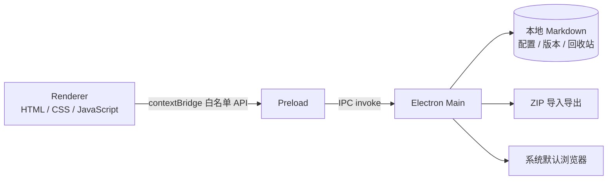

# Prompt Flow Manager

> 一款本地优先的提示词与 AI 工作流桌面管理工具。

[](https://nodejs.org/)
[](https://www.electronjs.org/)
[](https://github.com/qiqiqi-max/Prompt-Flow-Manager)
[](LICENSE)

Prompt Flow Manager 用于集中整理项目开发中反复使用的提示词、模板和执行流程。所有内容都以 Markdown 文件保存在本地，不依赖云端服务，也不绑定任何特定 AI 平台；需要使用时，直接搜索、预览并复制到 ChatGPT、Claude、Codex 或其他工具即可。

它解决的不是“再做一个聊天客户端”，而是提示词资产散落、版本难追踪、流程难复用的问题。

## 目录

- [核心能力](#核心能力)
- [适用场景](#适用场景)
- [快速开始](#快速开始)
- [使用指南](#使用指南)
- [文件格式](#文件格式)
- [数据与备份](#数据与备份)
- [架构与安全](#架构与安全)
- [只读 MCP 接口](#只读-mcp-接口)
- [开发与测试](#开发与测试)
- [项目结构](#项目结构)
- [许可证](#许可证)

## 核心能力

| 能力 | 说明 |
| --- | --- |
| 分类管理 | 按项目阶段或自定义目录组织提示词、工作流与模板 |
| 项目上下文 | 保存项目名称、描述、技术栈、路径和约束；不同项目分别记忆填写值，快速搜索面板使用同一份项目上下文 |
| 独立运行记录 | 同一工作流可为不同项目创建多次运行，分别续跑；历史保存创建时的上下文与使用过的步骤图 |
| 全文搜索 | 搜索标题、标签和正文，支持关键词高亮及阶段、工程类型、标签筛选 |
| Markdown 编辑 | 编辑与预览原地切换，支持 `Ctrl+S` 保存、代码块一键复制 |
| 工作流可视化 | 根据工作流文件自动生成流程图，点击节点即可跳转到对应提示词 |
| 工作流执行 | 打开工作流后可「开始执行」：图上高亮当前步骤、给完成的打勾，逐步复制每一步的提示词；分支处让你选下一步，同名占位符在后续步骤自动预填，进度重启后可继续 |
| 多标签页 | 同时打开多个提示词，并在重启后恢复上次的标签页和活动状态 |
| 外部改动感知 | 命令行、MCP、git pull 或外部编辑器改了内容目录时，文件树和已打开的标签页自动刷新；正在编辑且有未保存改动时只显示提示条，由你决定重新加载还是保留自己的版本 |
| 版本历史 | 每次保存自动生成快照，可星标、查看差异和回滚；保存时可选填一句版本说明，历史里可事后编辑；默认保留最近 30 个未星标版本 |
| 安全删除 | 文件先进入回收站，可恢复；重要文件可锁定，主进程会强制阻止删除 |
| 导入与导出 | 导入单个 Markdown 或 ZIP 备份，导出单个提示词或整个内容库 |
| 项目装配 | 组合角色、技术栈与工程规约生成项目启动提示词，可导出为各 AI 工具的规则文件：CLAUDE.md、AGENTS.md、GitHub Copilot 的 .github/copilot-instructions.md、Cursor 的 .cursor/rules/project-rules.mdc 与旧格式 .cursorrules。导出哪些由勾选决定并会记住，默认只导出 CLAUDE.md 和 .cursorrules |
| 个性化 | 明暗主题、中英文界面、界面字号 60%–125% 七档缩放、自定义工程类型、可调节侧边栏 |
| 高效操作 | 最近打开、创建副本、文件树键盘导航和常用快捷键 |
| 收藏与常用 | 文件树右键收藏，侧边栏「收藏」一键打开；「常用」按复制次数和最近使用综合排序 |
| 启动自愈 | 启动时检查数据目录：摘掉回收站里点不动的幽灵记录、把孤立正文收养回可见状态、清掉写入中断留下的半截临时文件 |
| 可诊断 | 运行日志滚动写入 `logs/`（单文件 2 MB、最多 5 个），设置里可导出一份脱敏的诊断信息用于报障 |
| 升级提示 | 启动时查询 GitHub 最新发布版本并在右下角提示。只读版本号，不自动下载安装，不发送任何本机信息，设置里可完全关闭 |
| 只读 MCP 接口 | 自带一个 stdio 的 MCP server，把提示词库暴露给 Claude Code / Codex 等支持 MCP 的工具查询，提示词还能直接作为客户端的斜杠命令使用。**只有读操作**，没有任何写入工具 |
| 全局快捷键 | 在任何程序里按快捷键（默认 `Ctrl+Alt+Space`，默认关闭）弹出快速搜索框，输入即搜、`Enter` 复制；带占位符的就地填写，`{{include:}}` 自动展开。主窗口最小化时也能用 |
| 命令行入口 | `npm run pfm -- list / search / get / refs / check`，在终端或流水线里查询、体检提示词库。同样只有读操作；`check` 按退出码报告悬空引用与不可达步骤，可直接当 lint 用 |

应用对大规模提示词库做了针对性优化：文件内容与解析结果按修改时间和大小缓存，目录树与元数据一次遍历返回，搜索时复用正文索引。项目内置的基准脚本可用于复测这些性能路径。

## 适用场景

- 为不同项目阶段建立可复用的提示词库，例如需求、编码、审查、测试和部署。
- 把一组相互依赖的提示词编排成可视化工作流。
- 在调整提示词时保留历史版本，随时对比或回滚。
- 以普通 Markdown 文件沉淀团队或个人方法，不被专有格式锁定。
- 在离线或对隐私敏感的环境中管理提示词内容。

## 快速开始

### 环境要求

- Node.js 18 或更高版本，推荐 Node.js 20+
- npm 9+
- Windows 10/11（当前打包目标）

### 从源码运行

```bash
git clone https://github.com/qiqiqi-max/Prompt-Flow-Manager.git
cd Prompt-Flow-Manager
npm ci
npm start
```

Windows 用户也可以在安装依赖后双击 `启动应用.bat`。

### 构建便携版

```bash
npm run dist
```

生成的 portable `.exe` 位于 `dist/`。构建前会自动同步渲染进程依赖到 `src/vendor/`，最终程序不需要联网加载前端库。

## 使用指南

| 操作 | 入口或快捷键 |
| --- | --- |
| 新建提示词 | 工具栏“+ 提示词”、`Ctrl+N`，或文件树右键菜单 |
| 新建工作流 | 工具栏“+ 工作流” |
| 搜索内容 | 顶部搜索框，`Ctrl+Shift+F` 聚焦 |
| 编辑与保存 | 内容区“编辑”，`Ctrl+S` 保存；保存按钮旁可选填版本说明，`Ctrl+Shift+S` 聚焦说明框，Enter 保存 |
| 复制提示词 | 内容区“复制” |
| 全局快速搜索 | 工具栏“设置”→“全局快捷键”开启（默认关闭，默认组合键 `Ctrl+Alt+Space`，可改）。按下后输入关键词，`↑` / `↓` 选择，`Enter` 复制，`Esc` 收起 |
| 按步骤执行工作流 | 打开工作流，点流程图上方“开始执行”；每步“复制本步”后自动前进，也可“跳过”“上一步”“退出执行”，下次打开点“继续执行” |
| 创建副本 | 文件树右键“创建副本” |
| 查看版本 | 内容区“历史”打开版本抽屉；每行的说明描述这一行的内容，点 ✎ 编辑说明 |
| 重命名、移动、删除 | 内容区操作按钮或文件树右键菜单 |
| 锁定文件 | 文件树右键“锁定（防误删）” |
| 收藏文件 | 文件树右键“收藏”，收藏的文件出现在侧边栏“收藏”栏，点一下即打开 |
| 打开常用提示词 | 侧边栏“常用”栏，按复制次数和最近使用综合排序，悬停可看次数和最后使用时间 |
| 导入或导出 | 顶部工具栏相应按钮，`Ctrl+E` 导出备份 |
| 切换主题 | 工具栏主题按钮，`Ctrl+Shift+L` |
| 调整界面字号 | 工具栏“设置”→“界面字号”，60% 到 125% 共七档，默认 90% |
| 文件树导航 | 聚焦文件树后使用 `↑` / `↓` |
| 多选文件 | 文件树里 `Ctrl+点击` 逐个选，`Shift+点击` 或 `Shift+↑/↓` 按屏幕上可见的顺序选一段（折叠和被筛掉的不算），`Esc` 清空 |
| 批量移动、打标签、删除 | 选中 2 个及以上文件后，用树上方的批量操作条；移动时同名自动改名、被引用的工作流汇总后问一次是否同步，删除时锁定的文件跳过；结束后汇总成功、失败和跳过的文件及原因 |
| 关闭抽屉或退出编辑 | `Esc` |

## 文件格式

### 提示词

提示词是带 YAML frontmatter 的 `.md` 文件。正文就是复制到 AI 工具中的实际内容。

```markdown
---
title: 需求分析
stage: project-init
projectType: 前端项目
tags: [需求, 分析]
description: 梳理项目目标、范围和验收标准
---

# 任务

请根据以下背景梳理需求……
```

`version`、`createdAt` 和 `updatedAt` 由应用自动维护，无需手动填写。

### 占位符

正文里用方括号标出复制前需要填写的部分。复制时会弹出填写面板，也可以在预览里点占位符就地填写。填的值只用于复制出去的正文，不修改文件。

| 写法 | 含义 |
| --- | --- |
| `[在此描述要实现的功能]` | 普通占位符，方括号里的文字是填写提示 |
| `[语言\|Python\|Go\|Rust]` | 带选项：第一段是提示，后面每段是一个选项。填写时可以从下拉框选，也可以输入自定义值 |
| `[目标=提升性能]` | 带默认值：`=` 左边是提示，右边是默认值，填写框会预填默认值 |
| `[语言=Go\|Python\|Go\|Rust]` | 选项和默认值同时使用，默认值写在第一段 |

默认值的生效规则：

- 复制面板里，有默认值的框预填默认值。如果这个占位符以前填过，优先预填上次填的值。点「填好并复制」时以框里的内容为准：不改就用默认值，清空就原样保留占位符。点「直接复制原文」则所有占位符都不替换。
- 预览里，没填过的默认值占位符显示的是默认值本身，带「默认」角标。就地填过其他占位符后复制，没动过的默认值占位符按默认值填入。

填写框都支持多行，可以直接粘贴报错或代码。复制面板里 Enter 跳到下一项，Shift+Enter 换行，Ctrl+Enter 填好并复制。预览里就地填写时 Enter 确定，Shift+Enter 换行。

以下情况不当作带选项或默认值的占位符，会按普通文字或普通占位符处理：

- 只有两段的 `[是|否]`：整段是普通占位符的提示文字，不生成选项。
- 有空段的 `[a||b]`、含 `\|` 的写法：同上。
- `=` 两侧有空格的 `[x = 1]`，比较写法 `[a==b]`、`[a>=b]`，多个等号的 `[a=b=c]`，以及带 `://` 的网址：都当作普通占位符。默认值本身不能包含 `=`。
- Markdown 表格单元格里含 `|` 的方括号不是占位符，因为 `|` 会先把单元格切开。表格里不含 `|` 的普通占位符仍然有效。
- 链接、图片、引用式链接、任务列表复选框、行内代码和代码块里的方括号，一律不是占位符。

### 工作流

工作流同样使用 Markdown，通过 frontmatter 中的 `flow` 描述步骤关系：

```markdown
---
title: 完整项目流程
flow:
  - id: requirement
    prompt: prompts/project-init/需求分析.md
    label: 需求分析
    next: implementation
  - id: implementation
    prompt: prompts/code-generation/功能实现.md
    label: 功能实现
---
```

打开工作流后，应用会渲染流程图；节点引用的是项目内提示词的相对路径。

点流程图上方的「开始执行」进入执行模式：入口步骤高亮，面板里预览当前步骤的提示词正文（`{{include:}}` 已展开）。
「复制本步」的填写面板和主界面的复制是同一套，复制完这一步记为完成并前进：

- `next` 只有一个就直接前进；有多个时列出可前往的步骤让你选。
- 汇合点（被多个步骤指向的步骤）要等它前面的分支都完成或跳过之后才能进入。不打算走的分支用「跳过」结束掉。
- 引用的提示词不存在的步骤不能复制，会给出提示，可以跳过。
- 同一次执行里填过的占位符，后续步骤遇到同名的会预填（可修改）。
- 每次执行保存为 `workflow-runs.json` 中的独立运行，重启后可以选择并继续。新建运行会保留已有历史；工作流改动后需确认继续，进度才会按新图修复。改名或在工作流目录内移动时记录跟随；删除或移出目录时保留历史并停止执行。

### 项目上下文与运行历史

在侧边栏选择项目，通过“管理项目”新建、编辑、复制或删除档案。项目路径只是填写用的文本，应用不会扫描该目录。固定占位符 `[项目名称]`、`[项目描述]`、`[技术栈]`、`[项目路径]`、`[项目约束]`（以及对应英文标签）会从档案预填；其他填写值也分别记在各项目中。未选择项目时使用原有全局记忆，选中项目后不会回落到其他项目或全局的值。快速搜索面板只读取这些值。

创建工作流运行时可命名并选择绑定项目。运行使用创建时的上下文快照，之后切换或编辑项目不会改变它；未绑定项目的运行也固定使用创建时的全局记忆。运行中填写的值只属于该运行。想使用更新后的档案时，新建一次运行。

“运行历史”可查看上下文、填写值、步骤和状态，工作流文件删除后仍能查看。历史保存步骤图与路径，不保存提示词旧正文，不能用它重放旧版内容。删除项目之前需解除相关运行的绑定，解除后运行快照仍保留。

名称最多 200 字符，档案其他字段和单个占位符值最多 20000 字符；过长粘贴会完整保留并显示提示，修正后才能保存或复制。最多保存 100 个项目、1000 次运行，达到上限需先整理已有记录。

旧 `config.flowRuns` 在首次启动时幂等迁移到独立运行，并保留为只读迁移备份。回退旧版应用不能同步新运行。

## 数据与备份

应用采用本地文件存储，不需要数据库或账号。

| 运行方式 | 数据目录 |
| --- | --- |
| `npm start` 源码运行 | 当前项目目录 |
| 打包后的便携版 | `%APPDATA%\prompt-flow-manager\` |

上表是内容与业务数据目录。源码运行时，`config.json`、`usage.json` 等设备设置仍使用 Electron 的 userData 目录；项目档案和独立运行随内容放在当前项目目录。测试设置 `PFM_DATA_DIR` 时，两类数据都隔离到指定的临时目录。

主要数据目录如下：

- `prompts/`：提示词库
- `workflows/`：工作流定义
- `templates/`：提示词模板
- `.versions/`：版本快照
- `.trash/`：回收站
- `logs/`：滚动日志（`app.log` 及归档，单个 2 MB、最多 5 个，超出自动轮转）
- `config.json`：主题、语言、界面字号、窗口状态、标签页和锁定列表等设置
- `projects.json`：项目档案、当前选中项目和各项目的填写记忆
- `workflow-runs.json`：独立运行、上下文快照、步骤图和选中运行
- `drafts/`：编辑中尚未保存的草稿，用于意外退出后恢复
- `usage.json`：使用统计（每个提示词的复制次数和最后使用时间，最多 1000 条，超出时淘汰最久没用的）和收藏列表（最多 200 条）。和 `config.json` 在同一目录；改名、移动时跟着文件走，删进回收站时保留，清空回收站时一起清掉

工具栏的“导出”会把 `prompts/`、`workflows/`、`templates/`、版本历史 `.versions/` 和可迁移设置打包为 ZIP。完整备份包含带 SHA-256 校验值的内容清单；文件缺失、被修改或混入额外文件时会停止导入；校验通过后如果写入中途失败，会撤回本次导入的文件、版本、设置和回收站条目；导入期间发起的保存、删除、改名和设置写入会等导入结束后再执行。导入 ZIP 前会先显示文件数、历史版本数、回收站条目数、是否包含设置以及重名文件，确认后才写入。导入这种完整备份时，文件会回到原来的目录，版本历史、星标和版本说明会跟随恢复；遇到同名文件时会另存为新文件，不会覆盖现有内容。可迁移设置包括锁定状态、自定义工程类型和占位符填充记忆，会与当前设置合并；主题、语言、窗口位置、标签页和升级检查状态保留当前设备的值。完整备份也包含回收站；导入时这些条目会追加到当前回收站，并生成新的内部编号，不会替换现有回收站内容。使用统计和收藏（`usage.json`）属于本机数据，**不进完整备份**：常用排序反映的是这台机器上的使用习惯，换机器后从新机器的使用重新积累；导入备份也不会改动当前设备的统计和收藏。

完整备份还包含 ZIP 条目 .pfm/projects.json 与 .pfm/workflow-runs.json，预览显示项目和运行数量。导出先取得一致快照，再写入压缩包；导入为档案和运行生成新 ID，保留本机当前选择。同名工作流、提示词及嵌套 include 都指向本次导入的副本，不改动已有文件；未包含的依赖会让相关运行保持不可执行。业务文件与正文、版本、设置、回收站一起回滚，旧备份没有这两个文件时仍可导入。

备份包含项目路径、约束和填写值，分享前请检查。档案中的机器路径作为普通文本保留，换机器后可自行编辑；诊断信息只包含业务数量和状态，不包含项目字段或运行填写值。

## 架构与安全



- Electron 渲染进程启用 `contextIsolation`，关闭 `nodeIntegration`，只通过 preload 暴露白名单 API。
- 渲染进程默认开启 `sandbox`。极少数环境下沙箱进程起不来会整窗白屏，因此启动时若检测到
  渲染进程无法就绪，会就地降级重建窗口并把降级原因写进日志，而不是让用户面对一片空白。
- 页面启用内容安全策略（CSP），Markdown 预览经过 DOMPurify 清理。
- 文件访问统一校验根目录边界，阻止路径穿越；版本文件名也经过白名单校验。
- Markdown 中的 HTTP(S) 链接交给系统浏览器打开，其他外部协议会被拦截。
- ZIP 导入会过滤非 Markdown 文件、限制单项大小，并对重名文件生成安全的新名称。
- 配置写入串行化，减少多个界面状态同时保存造成的数据覆盖。
- 导出项目规则只写主进程写死的几个相对路径，渲染进程传来的其他路径一律丢弃；
  路径上的任何一级目录或目标文件是符号链接或 junction 时整次拒绝，已有文件先询问再覆盖。
- 正常运行采用单实例锁，避免两个进程同时修改同一个数据目录。
- **全程只有一处出网**：启动时向 GitHub 查询最新发布版本号。请求带固定 User-Agent、8 秒超时、
  响应体上限 256 KiB，不携带任何本机标识，失败一律静默；发布页地址是代码里的常量，
  不取自响应内容。设置里关掉后连请求都不会发出。除此之外应用不联网。

## 只读 MCP 接口

把本地提示词库接到支持 [MCP](https://modelcontextprotocol.io) 的 AI 工具上（Claude Code、Codex 等），
让它们直接查"我库里有哪些提示词、某条讲了什么、哪个工作流用它"。

**全部是读操作**：列库、检索、读正文、看工作流图、查引用关系。没有写入工具，
应用本身仍然不调用任何 AI 服务——数据流向是使用者来读这个库。

在 MCP 客户端的配置里加一项：

```json
{
  "mcpServers": {
    "prompt-flow-manager": {
      "command": "node",
      "args": ["<仓库绝对路径>/mcp/server.js"],
      "env": { "PFM_DATA_DIR": "<可选：要暴露的提示词库目录>" }
    }
  }
}
```

不设 `PFM_DATA_DIR` 时用仓库目录（与源码运行时应用自己的数据目录一致）。
注意 server 本身是从**源码目录**跑起来的——它不随安装包分发（portable 版每次运行都解压到
临时目录，没有稳定路径可指），所以 `args` 要写你克隆或解压出来的仓库路径；
`PFM_DATA_DIR` 指的是"要暴露哪个提示词库"，打包版用户的库在 `%APPDATA%\prompt-flow-manager\`。
打包版的数据在 `%APPDATA%\prompt-flow-manager\`，那种情况下请显式指明。

可用工具：

| 工具 | 用途 |
| --- | --- |
| `library_overview` | 库里有多少提示词/工作流、阶段分布、工程类型与标签清单 |
| `prompts_list` | 列提示词（不含正文），可按阶段或工程类型过滤 |
| `prompts_search` | 全文检索，返回命中片段 |
| `prompts_get` | 读一条提示词的元数据与正文（超长会截断并注明） |
| `workflows_list` | 工作流及其步骤图，含分支与"从入口走不到的步骤" |
| `prompts_references` | 某条提示词被哪些工作流引用；不传参数则做全库悬空引用体检 |

除了工具，server 还声明了 MCP 的 **prompts** 能力：`prompts/` 下的每条提示词在 Claude Code
等客户端里直接是一个斜杠命令，选中后客户端拿到的正文已经剥掉 frontmatter、展开了
`{{include: ...}}`，并按传入的参数填好了占位符。include 与占位符语法和桌面应用共用；CLI/MCP 不读取项目档案、运行快照或私有填写记忆，桌面应用的项目预填需在应用中使用。

- **命令名**取自路径：去掉 `prompts/` 和 `.md`，ASCII 字母转小写，空格、斜杠、标点合成一个 `-`，
  中文保留。例如 `prompts/project-init/需求分析.md` → `project-init-需求分析`。
  几个文件得到同一个名字时（如 `a b.md` 与 `a-b.md`），**这一组全部**加上 `--<路径哈希 8 位>`，
  名字只由路径决定，与目录遍历顺序无关。
- **参数**来自正文里的 `[提示文字]` 占位符（含 include 进来的片段里的），名字是
  `arg<序号>`，提示文字里有英文时再接一段净化后的小写片段（如 `arg1_react_typescript_vite`），
  描述就是提示文字。参数都不是必填：没传的占位符原样保留。
- `prompts/snippets/` 下是给 include 拼装用的片段，**不**列成斜杠命令，但仍可被 include、
  也仍可用 `prompts_get` 读取。
- include 的路径闸和工具一致（只放行三个内容目录下的 `.md`）；正文超过长度上限时截断，
  并在正文末尾注明。未知的命令名、未知参数名、参数值不是字符串都返回 JSON-RPC 的 -32602。

安全边界：只读；路径只允许 `prompts/` `workflows/` `templates/` 下的 `.md`
（`../` 逃逸、`.versions/`、`config.json`、日志与草稿目录一律拒绝）；返回正文有长度上限。
没有引入第三方 MCP SDK——协议面只有 initialize / tools/list / tools/call / prompts/list / prompts/get / ping，
沿用项目"运行时依赖最小"的取舍（目前只有 archiver 与 yauzl 两个）。

## 开发与测试

```bash
npm run lint            # eslint 静态检查
npm test                # 静态约束、语法、ZIP、安全、文档漂移与回归检查
npm run test:ui         # 启动真实 Electron 窗口并验证渲染及关键点击流程
npm run test:fn         # 在临时目录执行端到端功能自检
npm run test:tabs       # 验证重启后标签页及正文恢复
npm run test:debounce   # 验证配置写入防抖与关窗前 flush
npm run test:close      # 验证关窗落盘握手
npm run test:close-unsaved # 验证关窗前保护未保存草稿
npm run test:draft-recovery # 验证意外退出后恢复草稿
npm run test:save-conflict # 验证保存冲突提示
npm run test:external-change # 验证应用之外的改动会刷新文件树和已打开的标签页
npm run test:layout-small # 验证最小窗口在多语言、主题和缩放下的布局
npm run test:render     # 验证 markdown 渲染成本上限
npm run test:heal       # 验证启动时的数据目录自愈
npm run test:logger     # 验证滚动日志与诊断信息导出
npm run test:sandbox    # 验证渲染进程沙箱及起不来时的就地降级
npm run test:sandbox-required # 强制沙箱启动并禁止降级（CI 环境验证）
npm run test:update     # 验证启动时的版本检查（超时、静默失败、可关闭）
npm run test:contrast   # 逐对计算两套主题的配色对比度与焦点可见性
npm run test:placeholders # 占位符提取与填充，含选项 / 默认值语法与判定边界
npm run test:frontmatter # frontmatter 安全生成与解析
npm run test:project-types # 项目类型新增、删除和最少保留规则
npm run test:rule-export # 规则文件导出：路径白名单、链接拒绝、保护已有文件（自带反向对照）
npm run test:composer-meta # 装配器项目类型与标签推断
npm run test:version-store # 版本历史存储、星标、版本说明和裁剪规则
npm run test:trash-store # 回收站索引、存放名校验和部分清空
npm run test:usage-store # 使用统计与收藏：计数、上限、改名迁移和常用排序
npm run test:file-move # 改名时正文和版本历史一起移动
npm run test:workflow-refs # 工作流引用精确替换
npm run test:backup-import # 完整备份按原目录恢复
npm run test:backup-config # 备份设置迁移
npm run test:backup-preview # 导入预览摘要
npm run test:backup-manifest # 备份清单校验
npm run test:import-transaction # 导入回滚工具
npm run test:write-gate # 导入期间写入暂停
npm run test:workspace-stores # 项目与运行存储：容量、损坏保护与原子写入
npm run test:project-context # 项目与运行预填隔离、默认值与显式清空
npm run test:write-queue # 多 key 预留、并发写入与独占导入顺序
npm run test:workspace-service # 旧进度迁移、独立结算与文件生命周期
npm run test:workspace-ui # 工作区界面、过期请求与关窗等待
npm run test:workspace-restart # 两次真实启动恢复项目选择、预填值和独立运行
npm run test:workspace-backup # 完整备份的业务校验、容量、ID与依赖映射
npm run test:workspace-backup-integration # 真实备份往返、重名副本、快照并发与故障回滚
npm run test:export-file # 单文件安全导出
npm run test:failure-feedback # 失败提示回归
npm run test:draft-store # 草稿存储
npm run test:import-rollback # 完整备份中途失败后整体撤回
npm run test:ui-failure # 界面保存失败提示
npm run test:includes   # 模板片段引入与嵌套解析
npm run test:quick-launch-logic # 全局快捷键校验、注册与回滚
npm run test:quick-launch # 全局快捷键快速搜索面板（启动真实 Electron）
npm run test:library-watch # 外部改动的事件合并与自写过滤
npm run test:tree-selection # 文件树多选：Ctrl/Shift 选择只取可见行
npm run test:tag-rewrite # 批量打标签只改 tags 字段，其余 frontmatter 原样
npm run test:batch-ops  # 批量操作部分失败汇总、进行中拒绝重复触发、同名生成新名字

npm run test:flow-graph  # 工作流图：分层、成环、不可达步骤
npm run test:flow-run    # 工作流执行状态机：候选下一步、汇合点、回退、坏进度修复
npm run test:flow-run-copy # 读盘或填写期间切换步骤，旧复制请求不会写剪贴板或推进执行
npm run test:flow-run-integration # 真实重启恢复执行进度，并验证占位符、复制统计与批量删除
npm run test:reverse    # 反向对照：版本检查的每个修复点撤掉都必须变红
npm run test:reverse-split # 反向对照：自检模块拆分的每个修复点撤掉都必须变红
npm run test:quick      # 日常快速检查，不启动 Electron
npm run test:all        # 完整检查（不含 sandbox-required 和 packaged）
npm run bench           # 生成 1000 条提示词并执行搜索性能基准
```

功能测试使用独立临时目录，不会读写真实提示词库。测试过程里出现的预期错误日志用于验证锁定、路径穿越和非法版本名等防护是否生效。

常用开发命令：

```bash
npm run sync-vendor   # 从 node_modules 更新本地前端依赖
npm run build         # 构建 Windows 安装目标
npm run dist          # 构建 Windows portable 版本
npm run test:packaged # 对打包产物跑自检（须先 dist）
```

打包产物有单独一层检查：开发模式下代码目录与数据目录恰好重合，路径写错也照样能跑，
只有打包后两者分叉才会暴露成白屏。改了打包配置、路径解析或首次运行的种子拷贝，
跑一次 `npm run dist && npm run test:packaged`。

改代码前请先读 [CONTRIBUTING.md](CONTRIBUTING.md)，尤其是反向对照那一节：
本项目要求每条新增断言都必须证明「撤掉修复会变红」，否则算空断言。

## 项目结构

```text
Prompt-Flow-Manager/
├── electron-main.js         # 主进程、IPC、文件与窗口管理
├── preload.js               # contextBridge 白名单接口
├── quick-launch-preload.js  # 快速搜索面板的最小白名单接口
├── lib/
│   ├── zip-import.js        # ZIP 安全导入逻辑
│   ├── logger.js            # 滚动文件日志
│   ├── diagnostics.js       # 诊断信息收集与导出
│   ├── sandbox-state.js     # 沙箱开关判定与降级记录
│   ├── update-check.js      # 启动时查最新发布版本
│   ├── library.js          # 内容库数据层：正文缓存、元数据、全文搜索
│   ├── workflow-index.js   # 工作流引用索引与悬空引用体检
│   ├── quick-launch.js      # 全局快捷键：组合键校验、注册状态机、居中
│   └── selftest.js          # 测试专用代码（不参与正常启动路径）
├── cli/                     # 命令行入口（只读，复用同一份数据层）
├── mcp/                     # 只读 MCP server（stdio，不依赖 electron）
├── src/
│   ├── index.html           # 应用界面骨架
│   ├── styles.css           # 主题与组件样式
│   ├── renderer.js          # 渲染进程交互逻辑
│   ├── i18n.js              # 中英文文案
│   ├── frontmatter.js       # frontmatter 解析与自动字段更新
│   ├── flow-graph.js        # 工作流图：步骤解析、分层、成环、不可达
│   ├── quick-launch.*       # 全局快捷键呼出的快速搜索面板（独立窗口）
│   ├── flow-run.js          # 工作流执行状态机：入口、候选下一步、汇合点、回退、进度修复
│   ├── selftest/            # 自检脚本（在页面上下文里执行的真实 .js）
│   └── vendor/              # 本地化的渲染进程依赖
├── prompts/                 # 内置提示词示例
├── workflows/               # 内置工作流示例
├── templates/               # 提示词模板
├── tests/                   # 静态、UI、功能、标签恢复测试与基准
├── scripts/                 # 构建辅助脚本
├── build/                   # 应用图标与构建资源
└── package.json
```

## 许可证

本项目基于 [MIT License](LICENSE) 开源。
